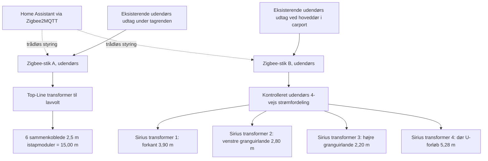

# Strømfordeling og kabelplan, julelys 2026

**Status: teknisk dispositionsplan 21.11.2026. Ikke endeligt godkendt til indkøb eller opsætning.**
Ingen udtag er fysisk inspiceret. Offentligt repository: ingen præcis placering, ledningsdiagram over husets faste installation eller personfølsomme oplysninger.

## Grundprincip: 2 separate HA-zoner

Det er et **logisk diagram**. Placering, strømforsyning og kabler skal godkendes efter fysisk kontrol. 230V-delen samles helst nær det eksisterende udtag i den bedst mulige, producentgodkendte beskyttelse. Fra hver transformer føres lavvoltsledningen til starten af sin lyskæde.

## Kabellængder, som er dokumenteret af producenten

| System | 2026-anvendelse | Transformer | Medfølgende tilslutningsledning |
| --- | --- | --- | --- |
| Sirius Top-Line Energy Iskrystal startsæt 2,5 m + 5 supplementsæt | 15 m tagrende, 600 LED | Én startsættransformer, 80V/24W mærkning (kontrollér på produkt) | **5 m** fra transformer til første lyssektion |
| Sirius Easy-Line 40 LED, 3,9 m | Carportforkant | **31V, 3,6W, IP44** | **5 m** |
| Sirius Easy-Line 80 LED, 7,9 m, **3 særskilte kæder** | Venstre side, højre side, dør | **31V, 3,6W, IP44** pr. kæde | **5 m pr. kæde** |

Producentens Easy-Line (standard) oplyses **ikke at kunne udbygges**. **Easy-Line Connect** er en anden produktserie, og dens 5 m forlængerkabel må **ikke uden fabrikantbekræftelse** bruges til de valgte almindelige Easy-Line-kæder.

**Effekt:** Fire Easy-Line-transformere med mærkning 3,6 W hver og én Top-Line-transformer mærket 24 W giver nominelt 38,4 W i transformereffekt, **ikke et målt eller dokumenteret samlet netforbrug**. Stik og kabler skal stadig vælges efter typeskilte og standarder. Effekt er næppe den svære del, men vandbeskyttelse, korrekt jord og plads til fire fysiske transformere er.

### Kabelrutetjek før indkøb

Mål den **faktiske kabelvej** langs væg, hjørne og loft fra den påtænkte transformerplacering, ikke luftlinjen. Første lysdiode skal kunne nås med medfølgende 5 m kabel, uden stramning.

| Strækning fra mulig 4-vejs fordeling ved hoveddøren | Tilgængeligt ud fra produktspecifikation | Opmåling | Resultat |
| --- | ---: | --- | --- |
| Til start på carportens forkant | 5,0 m | AFVENTER | AFVENTER |
| Til start på venstre granguirlande | 5,0 m | AFVENTER | AFVENTER |
| Til start på højre granguirlande | 5,0 m | AFVENTER | AFVENTER |
| Til start på hoveddørens guirlande | 5,0 m | AFVENTER | AFVENTER |
| Under tagrenden: strømudtag til start på facade-iskrystaller | 5,0 m | AFVENTER | AFVENTER |

Hvis en rute overstiger 5 m, må der **ikke** bare sættes en tilfældig 31V-forlænger på. Muligheder: Flyt fordelingen på egnet måde, vælg et alternativt kædesystem med dokumenteret kompatibel forlængelse, eller vælg et godkendt udendørs 230V-kabel til en egnet anden placering. Kablets længde kan ikke fastlægges fra facadefotos alene.

## Produkter til fordeling og deres begrænsninger

### Kandidat 1: Goobay udendørs stikdåse med 4 Type-F-udtag

- Udendørs IP44-model med fire udtag og låg. Pris observeret **111 kr.** hos avXperten 21.11.2026 (tidligere shortlist satte 149 kr.).
- **Ikke godkendt til køb endnu:** Kontroller om alle fire Sirius-transformere fysisk kan være isat samtidig **uden at spænde imod dæksler/låg**, og om IP44 gælder med alle stik tilsluttet i den ønskede orientering.
- Kontroller at modellen kan fastgøres lovligt og stabilt på det ønskede sted. Den fundne Goobay-model er primært en havefordeler med jordspyd og 2 m tilledning, **ikke uden videre en vægmonteret boks**.

Link: https://www.avxperten.dk/udendoers-stikdaase/udendoers-stikdaase-4-udtag-ip44-goobay.asp

### Kandidat 2: Udendørs beskyttelsesboks

- **Elworks 9051919**, IP54, **32,5 x 21 x 11,5 cm**, 5 kabelindgange, ca. **78 kr.** ved jem & fix. Egnet i princippet til stikdåser og transformere.
- **Afgørende forbehold:** IP54 gælder kun ved korrekt lukket låg, intakte pakninger, kabeludgange ikke vendt opad og **kabeldiametre mellem 6,9 og 10,5 mm**. Vi kender ikke diameteren på Sirius' lavvoltsledninger. **Boksen må ikke beskrives som IP54 efter samling, før diametre og pakninger er verificeret**.
- Alternativ **E-line 8181007**, IP54, ca. 34 x 23 x 13 cm, **125 kr.** hos LavprisEL, kabelindgange til **6-9 mm** ledninger. Samme begrænsning og pladscheck.
- Udendørs bokse må ikke lukkes omkring udstyr på en måde, der er i strid med producentens varme-, placering- eller fugtanvisninger.

Links:
- https://www.jemogfix.dk/samleboks-til-udendoers-elartikler-elworks/2115/9051919/
- https://www.lavprisel.dk/e-line-udendoers-kabelboks-1078090

**Konklusion:** En IP44-fordeler under tilstrækkelig overdækning kan være en god løsning, hvis producentens samlede IP- og monteringsbetingelser opfyldes. En ekstra boks er en **mulig** forbedring, ikke automatisk nødvendig og ikke automatisk sikker. Fire store transformere + kabelgennemføringer skal prøvemonteres.

## Zigbee-stik, jord og udendørs forhold

- NOUS A6Z er dokumenteret understøttet i Zigbee2MQTT og IP44-klassificeret. Produktet bruger **Type F/Schuko**; det siger **ikke** noget om, hvilken type de to eksisterende udendørs udtag har.
- Ved dansk Type K-stikkontakt skal jordforbindelsen gennem hele kæden kontrolleres; en Schuko-stikprop får **ikke automatisk virksom jord** i dansk jordkontakt. Hvis klasse I-udstyr tilsluttes, kræves korrekt jordforbindelse. Brug kun godkendt og egnet løsning, som bevarer både jord og udendørs beskyttelse. Ved usikkerhed: autoriseret elinstallatør.
- Smart-stikkets IP44 skal også vurderes **mens det sidder i det faktiske vægudtag**, herunder evt. klaplåg, plads og afløbsretning.
- Test udendørs Zigbee-rækkevidde efter parring. På NOUS A6Z kan genstartstilstand via Zigbee2MQTT sættes til `off`, `on` eller `restore`; start med `off` som et forsigtigt valg og test kalender-automatisering.
- Kontroller, at strømudtagene er beregnet til udendørs anvendelse og egnet fejlstrømsbeskyttelse. Brug kun udendørsegnede forlængerledninger; ingen klemning ved døre, hjulpassage eller på offentlig gangvej.
- Der ændres **ikke** i faste elinstallationer som gør-det-selv-arbejde.

### Kilder (kontrolleret 21.11.2026)

- https://www.sik.dk/privat/gor-det-sikkert/el/gor-det-selv/udendors-el
- https://www.sik.dk/privat/goer-det-sikkert/el/brug-elprodukter-sikkert/hvilke-elprodukter-ma-du-selv-slutte-eller-koble
- https://www.sirius.dk/produkter/lysk%C3%A6der--forl%C3%A6ngere-/easy-line/easy-line-40-led--3-9m--varm-hvid
- https://www.sirius.dk/produkter/lysk%C3%A6der--forl%C3%A6ngere-/easy-line/easy-line-80-led--7-9m--varm-hvid
- https://www.sirius.dk/produkter/top-line-energy-iskrystal-starts%C3%A6t-100-led--2-5-m
- https://www.zigbee2mqtt.io/devices/A6Z.html
- https://www.avxperten.dk/udendoers-stikdaase/udendoers-stikdaase-4-udtag-ip44-goobay.asp
- https://www.jemogfix.dk/samleboks-til-udendoers-elartikler-elworks/2115/9051919/
- https://www.lavprisel.dk/e-line-udendoers-kabelboks-1078090

## Beslutning og næste praktiske kontrol

**Dispositionsvalg:** To HA-zoner og én fordeler til fire carport-transformere er fastholdt som arbejdstegning, **men den konkrete stikdåse/boks er IKKE godkendt**. Valg af forsyningskabel og endelig pris afventer disse kontrolpunkter:

- [ ] Et billede af **selve hvert udendørs strømudtag**, så stiktype, klaplåg og plads kan vurderes.
- [ ] Mål kabelføringsveje fra det foreslåede samlepunkt til hver kædes start (fem ruter ovenfor).
- [ ] Prøv fire transformer-stik i valgt fysisk stikdåse med låg.
- [ ] Bekræft korrekt jordforbindelse og IP med alting samlet.
- [ ] Godkend sikker placering, varmeforhold, ophæng og evt. kabelboksens pakninger.
- [ ] Revider budget og produktliste, når kabelbehov er kendt.

**Ingen elektriske dele er bestilt, og ingen installation er udført.**
