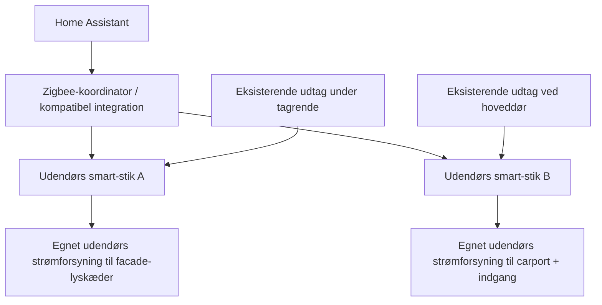

# Teknik, strøm og sikkerhed

Dette er en **plan**, ikke en udført elinstallation eller en elektrikers projektering.

## Fysiske zoner

| Zone | 2026? | Strømforsyning | Lys | HA |
| --- | --- | --- | --- | --- |
| A: Lang facade | Ja | Eksisterende udtag under tagrende, efter kontrol | Varmhvide istaplyskæder | Egen styring |
| B: Carport og hoveddør | Ja | Eksisterende udtag ved hoveddør, efter kontrol | Carportforkant + granguirlander + indgangslys | Egen styring |
| C: Hæk | Tidligst 2027 | Afklares | Varmhvidt lysnet/lyskæder | Egen styring |
| D: Plantede juletræer | Tidligst 2027 | Afklares | Varmhvide lavvoltkæder | Egen styring |
| E: Vinduer og evt. egen flisekant | Tidligst 2028 | Indendørs udtag / afklares | Stjerner / evt. lavvoltbelysning | Uafhængige zoner |

## Opmåling før indkøb

- **Facadens tagrende: 15,00 m (målt og oplyst af bruger, 20.11.2026).** Dette erstatter det tidligere usikre estimat på ca. 16 m bygningslængde og 17-18 m istaplys. Vælg **præcis 15 m lysende længde**, hvis muligt, eller kompatible moduler, der dækker strækningen uden uønsket overlængde. Kontrollér afslutninger, udhæng og forsyningskablets placering før bestilling.
- **Carportens forkant: 3,90 m (målt), venstre side: 2,80 m, højre side: 2,20 m (målt og oplyst 20.11.2026).** Hvis 3,90 m er vandret afstand og toppen skråner 0,60 m, er faktisk skrålængde ca. **3,95 m**. Hvis 3,90 m allerede er målt langs skråkanten, bruges 3,90 m. Top + de to lodrette sider udgør ca. **8,90-8,95 m**, men øverste lys og lodrette granguirlander tælles **som separate varer**.
- **Indgangsdør i carport (brugerens opmåling, 20.11.2026):** venstre side **2,15 m**, over døren **0,98 m**, højre side **2,15 m**. Omvendt U-form omkring dør = **5,28 m** ud fra de oplyste mål. Arbejdsramme for guirlande: **5,28 m faktisk forløb**, men produktets faste længde skal vælges (fx 5,5 eller 6 m **kun hvis den findes** og overskud kan skjules pænt). Hvis guirlanden fastgøres udenfor karmen, kontrolleres det faktiske forløb; de 5,28 m er ikke en måling af monteringslinjen.
- **Hoveddørens U-forløb: 5,28 m.** Carportens venstre lodrette side er **2,80 m** og højre **2,20 m**, i alt 5,00 m. Carportens forkant får sin egen ca. 4 m lyskæde, så forkanten må **ikke også tælles som guirlande** uden et særskilt designvalg.

## Regel for ikke-afkortelige produkter

**Lyskæder og granguirlander må ikke blot klippes over.** Vælg kun konkrete varer, når producentens faste **lysende længde**, start/slut, forsyningsledning, transformertype, eventuelle kompatible koblinger og maksimale antal moduler er kendt. Overlængde kræver en dokumenteret, sikker og diskret føring, ikke blot et overslag på samlet antal meter.

| Del | Mål | Princip for indkøb, ikke besluttet produkt |
| --- | ---: | --- |
| Facade/istaplys | 15,00 m | Et 15 m system eller producentgodkendt kombination, fx 3 x 5 m **hvis sammenkobling er godkendt** |
| Carportforkant/lys | 3,90-3,95 m | Produkt med ca. 4 m **lysende** længde og passende fødekabel |
| Carport venstre/granguirlande | 2,80 m | Eget passende modul; fx 3 m, hvis tilgængeligt og 0,20 m kan placeres pænt |
| Carport højre/granguirlande | 2,20 m | Eget passende modul; fx 2,5 m, hvis tilgængeligt og 0,30 m kan placeres pænt |
| Hoveddør/granguirlande | 5,28 m | Sammenhængende produkt/producentgodkendte moduler; fx 5,5 m eller 6 m, **kun hvis tilgængeligt og overskud håndteres** |

**Vigtigt:** Tal som 2,5 m, 3 m, 4 m, 5,5 m og 6 m er **søgelængder, ikke verificerede varianter i et bestemt produktsortiment**. Køb først, når en komplet produkt-/fordelingsplan med antal forsyninger og faktisk overdækning er godkendt.
- Højde til tagrenden og sikkert adgangsforhold: `AFVENTER`.
- Placering, type, jordforbindelse og beskyttelse ved de to eksisterende udtag: `AFVENTER`.
- Evt. udendørs Zigbee-signal og router/koordinator-rækkevidde: `AFVENTER`.
- Kapacitet og kabelføringsvej, uden krydsning af indkørsel/gangarealer: `AFVENTER`.

## 2026 indkøbskonfiguration

Den konkrete shortlist findes i [indkoeb-2026.md](indkoeb-2026.md). **Strømfordeling er nærmere analyseret i [stroemfordeling-2026.md](stroemfordeling-2026.md): en 4-vejs fordeler/boks må IKKE bestilles før fysisk kontrol af 4 transformere, stik, jord og pakninger.**

- **Facade:** seks sammenkoblingsbare Top-Line Iskrystal-sektioner á 2,5 m med én transformer: 15,00 m og 600 LED.
- **Carportforkant:** én separat Easy-Line kæde på 3,9 m.
- **Lodrette carportsider:** hver sin 2,7 m granguirlande og **hver sin 7,9 m varmhvide lyskæde**. Det er nødvendigt for at undgå at forbinde siderne med en utilstrækkelig kæde hen over den næsten 4 m brede top.
- **Hoveddør:** to mekanisk sammensatte guirlander på 2,7 m (5,4 m total) og **sin egen 7,9 m varmhvide lyskæde**. Placer cirka 12 cm guirlandeoverskud uden at afkorte.
- **Samlet carport:** 4 separate 230V/transformer-tilslutninger bag ét smart-stik og en egnet 4-vejs udendørs strømfordeling. Kræver kontrol af stik, IP, strømforbrug og ledningslængder.

Zigbee2MQTT og MQTT er konstateret i den tilsluttede Home Assistant, og ZHA er ikke aktiv. NOUS A6Z er en officielt understøttet Zigbee2MQTT-enhed, men den konkrete smart-stikmodel, jordforbindelse og udendørs dækning skal fortsat afklares før køb.

## Principskitse: El- og HA-opbygning

**Bemærk:** Skitsen er logisk, ikke en forskrift for fysisk samling. Én zone kan bestå af flere transformerbaserede lyskæder, men kun hvis fordeling, belastning og producenternes instruktioner tillader det. Forskellige produktserier må ikke antages at kunne sammenkobles.

## Sikkerhed før montering

1. Kontroller udtagenes egnethed, fejlstrømsbeskyttelse (RCD) og jordforbindelse. Få en fagperson til at vurdere forhold, der er usikre.
2. Alt monteret elektrisk udstyr, stik og forsyninger skal være beregnet til **udendørs brug**. IP44 kan være et minimum for udsatte dele, men højere kapslingsgrad kan være nødvendig afhængigt af eksponering og producentens anvisning.
3. Placér stik og transformere væk fra stående vand, hævet over terræn og så de ikke kan trække vand ind. En kasse er ikke automatisk sikker uden passende ventilations-/kabelanvisninger.
4. Brug egnede kabeltværsnit, ledningsføring og godkendte fordelingsløsninger. Undgå klemning ved døre, hjulpassage, træk og snublerisiko.
5. Lav **ingen** ændringer af den faste installation som gør-det-selv-arbejde. Skal der etableres nye faste udtag, bruges autoriseret elinstallatør.
6. Montér aldrig fra tagfladen alene for julebelysningen. Kan tagrenden ikke nås på sikker vis, hyr egnet fagperson og justér budget.
7. Til træer og dekorationer på jorden foretrækkes fabrikantgodkendt lavvolt efter strømforsyning.
8. Gennemgå strømforbrug og belastning for alle kæder og smart-stik før tænding.

## Materialevalg

- Ens varmt hvidt på alt lys, gerne fra samme system for et ensartet udtryk.
- Vælg system efter **reelle mål**, aftagelige tagrendekroge og sikker monteringshøjde.
- Smart-stik: vælg først når HA-teknologi (ZHA eller Zigbee2MQTT), danske stikforhold og udendørs klassifikation er verificeret.
- Flere kæder i samme zone skal have kompatible strømforsyninger; ikke klip og splejs fabriksfremstillede kæder uden dokumenteret mulighed.

## Vedligehold

Inspektion før hver sæson, efter kraftig vind/regn og inden nedtagning. Registrér eventuelle fejl i GitHub Issues.
