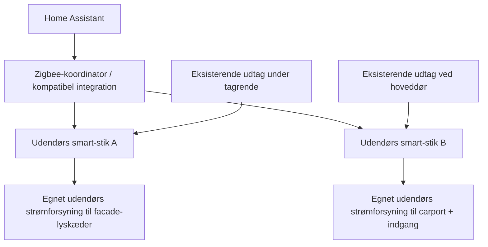

# Teknik, strøm og sikkerhed

Dette er en **plan**, ikke en udført elinstallation eller en elektrikers projektering.

## Fysiske zoner

| Zone | 2026? | Strømforsyning | Lys | HA |
| --- | --- | --- | --- | --- |
| A: Lang facade | Ja | Eksisterende udtag under tagrende, efter kontrol | Varmhvide istaplyskæder | Egen styring |
| B: Carport og hoveddør | Ja | Eksisterende udtag ved hoveddør, efter kontrol | Carportforkant + granguirlander + indgangslys | Egen styring |
| C: Hæk | Tidligst 2027 | Afklares | Varmhvidt lysnet/lyskæder | Egen styring |
| D: Plantede juletræer | Tidligst 2027 | Afklares | Varmhvide lavvoltkæder | Egen styring |
| E: Vinduer og evt. egen flisekant | Tidligst 2028 | Indendørs udtag / afklares | Stjerner / evt. lavvoltbelysning | Uafhængige zoner |

## Opmåling før indkøb

- **Foreløbig bygningslængde langs den lange facade:** ca. **16 m**. Beregnet som et **usikkert arbejdsskøn** ud fra BBR-hovedbygningens grundplansareal på 126 m² og proportioner på eksisterende facadefotos. Den offentlige BBR-oplysning oplyser **areal, ikke længde**, og det er derfor **ikke** et opmålt husmål.
- **Foreløbig dimensionering af istaplyskæder:** ca. **17-18 m**, inkl. forsigtig ekstra længde. Tagrendens faktiske længde, udhæng, hjørner og kabelføring er stadig `AFVENTER KONTROLMÅL`. Køb først, når produkternes faktiske lysende længde er kendt.
- Kilde for arealet: offentlige BBR-oplysninger gengivet af DinGeo (kontrolleret 20.11.2026). Proportionsskønnet er projektets eget, ikke en officiel måling.
- **Carportens forkant: 3,90 m bred** (brugeropmåling, 20.11.2026). **Højder på de to sider af den store åbning: 2,80 m og 2,20 m** (brugeropmåling, 20.11.2026; endnu ikke knyttet til højre/venstre side). Samlet forløb med de to sider og forkanten: **2,80 + 3,90 + 2,20 = 8,90 m**. Hvis forkanten skråner 0,60 m over en vandret bredde på 3,90 m, er selve forkantlinjen omkring 3,95 m og samlet forløb ca. 8,95 m. Foreløbigt: **ca. 4 m lys langs toppen og ca. 5 m lodrette guirlander**, plus tilpasning. Kontrollér faktisk monteringslinje og hvilken side der er højest før køb.
- **Indgangsdør i carport (brugerens opmåling, 20.11.2026):** venstre side **2,15 m**, over døren **0,98 m**, højre side **2,15 m**. Omvendt U-form omkring dør = **5,28 m** ud fra de oplyste mål. Arbejdsramme for guirlande: **ca. 6 m**, så der er plads til hjørner/tilpasning. Hvis guirlanden fastgøres udenfor karmen, kontrolleres det faktiske forløb; de 5,28 m er ikke en måling af monteringslinjen.
- Hoveddørens mål og carportåbningens mål er forskellige: **5,28 m** omkring dør (planlæg ca. 6 m) og **8,90 m** omkring stor carportåbning (heraf 3,90 m forkant og 5,00 m sider). Undgå at dobbeltregne forkantens lyskæde med guirlander.
- Højde til tagrenden og sikkert adgangsforhold: `AFVENTER`.
- Placering, type, jordforbindelse og beskyttelse ved de to eksisterende udtag: `AFVENTER`.
- Evt. udendørs Zigbee-signal og router/koordinator-rækkevidde: `AFVENTER`.
- Kapacitet og kabelføringsvej, uden krydsning af indkørsel/gangarealer: `AFVENTER`.

## Principskitse: El- og HA-opbygning

**Bemærk:** Skitsen er logisk, ikke en forskrift for fysisk samling. Én zone kan bestå af flere transformerbaserede lyskæder, men kun hvis fordeling, belastning og producenternes instruktioner tillader det. Forskellige produktserier må ikke antages at kunne sammenkobles.

## Sikkerhed før montering

1. Kontroller udtagenes egnethed, fejlstrømsbeskyttelse (RCD) og jordforbindelse. Få en fagperson til at vurdere forhold, der er usikre.
2. Alt monteret elektrisk udstyr, stik og forsyninger skal være beregnet til **udendørs brug**. IP44 kan være et minimum for udsatte dele, men højere kapslingsgrad kan være nødvendig afhængigt af eksponering og producentens anvisning.
3. Placér stik og transformere væk fra stående vand, hævet over terræn og så de ikke kan trække vand ind. En kasse er ikke automatisk sikker uden passende ventilations-/kabelanvisninger.
4. Brug egnede kabeltværsnit, ledningsføring og godkendte fordelingsløsninger. Undgå klemning ved døre, hjulpassage, træk og snublerisiko.
5. Lav **ingen** ændringer af den faste installation som gør-det-selv-arbejde. Skal der etableres nye faste udtag, bruges autoriseret elinstallatør.
6. Montér aldrig fra tagfladen alene for julebelysningen. Kan tagrenden ikke nås på sikker vis, hyr egnet fagperson og justér budget.
7. Til træer og dekorationer på jorden foretrækkes fabrikantgodkendt lavvolt efter strømforsyning.
8. Gennemgå strømforbrug og belastning for alle kæder og smart-stik før tænding.

## Materialevalg

- Ens varmt hvidt på alt lys, gerne fra samme system for et ensartet udtryk.
- Vælg system efter **reelle mål**, aftagelige tagrendekroge og sikker monteringshøjde.
- Smart-stik: vælg først når HA-teknologi (ZHA eller Zigbee2MQTT), danske stikforhold og udendørs klassifikation er verificeret.
- Flere kæder i samme zone skal have kompatible strømforsyninger; ikke klip og splejs fabriksfremstillede kæder uden dokumenteret mulighed.

## Vedligehold

Inspektion før hver sæson, efter kraftig vind/regn og inden nedtagning. Registrér eventuelle fejl i GitHub Issues.
